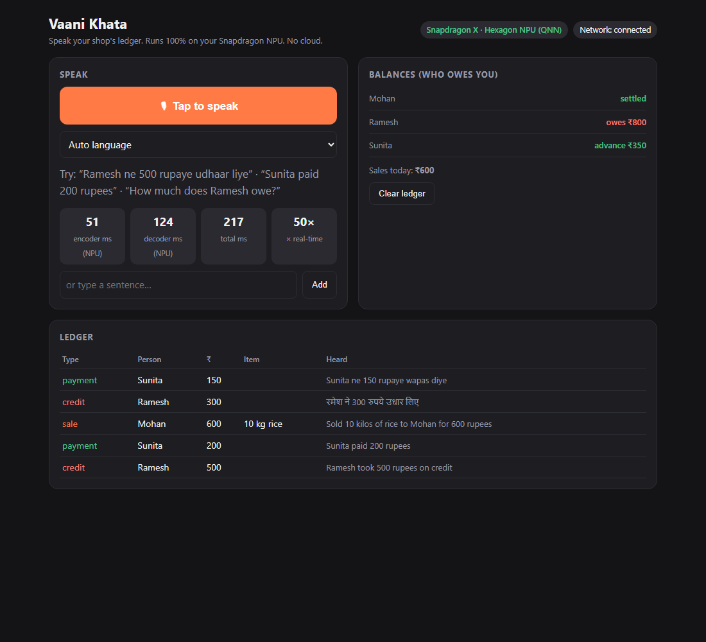

# Vaani Khata

**Speak your shop's ledger in Hindi, English or Hinglish. Speech recognition runs on the Snapdragon Hexagon NPU. Nothing leaves the laptop.**

Submission for the Snapdragon® AI Lab Build & Present Challenge (Qualcomm). Individual entry.



## The problem

Millions of small Indian shops track credit (*udhaar*) in paper khata books. Cloud ledger apps need connectivity, typing and an account, and they upload who-owes-what to a server. Speaking is the natural interface, but voice normally means sending audio to the cloud.

## What it does

1. Tap the mic and say things like *"Ramesh ne 500 rupaye udhaar liye"*, *"Sunita paid 200 rupees"*, *"Sold 10 kilos of rice to Mohan for 600 rupees"*.
2. **Whisper-Base (Qualcomm AI Hub build) runs encoder and decoder on the Hexagon NPU** through the ONNX Runtime QNN execution provider. Language (Hindi or English) is auto-detected.
3. A deterministic parser turns the transcript into ledger entries (credit, payment, sale) with person, amount, quantity and item.
4. Entries go into a local SQLite khata. Balances update, and you can ask *"How much does Ramesh owe?"* by voice.
5. Hindi and English spellings of a name (रमेश / Ramesh) merge into one customer.

## Measured on the target device

Samsung Galaxy Book4 Edge, Snapdragon X (X126100), Windows 11 ARM64, 16 GB.

| Whisper-Base encoder, 30 s audio | Latency |
|---|---|
| Hexagon NPU (QNN, fp16) | **~45 ms** (stable across all runs) |
| Oryon CPU (ORT CPU EP, fp32) | ~1.0 s typical (one outlier run at 0.3 s) |

End to end on the NPU (mel + encoder + 27-token decode) for a 10.8 s spoken clip: **~230-270 ms, about 45x real-time.**
Full tables, all runs and caveats (including the outlier and that the CPU baseline is the same architecture from the open ONNX export, not the identical file): [docs/benchmark.md](docs/benchmark.md).

## Run it (Snapdragon X, Windows on ARM)

You need **native ARM64 Python 3.12** (an x64/emulated Python cannot reach the NPU).

```powershell
winget install Python.Python.3.12 --architecture arm64
py -3.12-arm64 -m venv .venv          # or use the python.exe winget installed
.venv\Scripts\python -m pip install -r requirements.txt
.venv\Scripts\python setup_models.py  # downloads AI Hub Whisper-Base for Snapdragon X, tokenizer, mel filters
.venv\Scripts\python app\server.py    # then open http://127.0.0.1:8765
```

Benchmark: `.venv\Scripts\python app\bench.py`. Transcribe a file: `python app\asr.py clip.wav en`.

## Architecture

```
mic (browser, 16 kHz PCM) -> localhost server -> log-mel (numpy)
  -> Whisper encoder (NPU, QNN context binary) -> Whisper decoder w/ KV cache (NPU)
  -> tokenizer -> parser (Hindi/English/Hinglish rules) -> SQLite khata -> balances / answers
```

- `app/asr.py` NPU Whisper pipeline (device selection via ORT plugin EP API; raises if no NPU so numbers are never mislabeled)
- `app/ledger.py` transcript to entries, name canonicalization across scripts, SQLite khata
- `app/server.py`, `app/index.html` local app (binds to 127.0.0.1 only)
- `app/bench.py` NPU vs CPU benchmark

## Models and licences

- Qualcomm AI Hub Whisper-Base precompiled for Snapdragon X (`qualcomm/Whisper-Base`), see its model card for licence terms.
- OpenAI Whisper tokenizer and mel filters (MIT).
- `onnx-community/whisper-base` encoder, used only as the CPU baseline.

## Honest limits

- Parsing is rule-based. Unusual phrasing can be missed. Next step is a Llama 3.2 3B on the NPU for free-form sentences.
- Whisper-Base accuracy drops in noisy shops and with heavy accents. Whisper-Small is a drop-in upgrade.
- Hindi speech recognition was checked on typed transcripts for the parser and on English audio end to end; broader Hindi accuracy testing is still needed.
